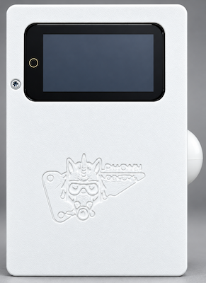
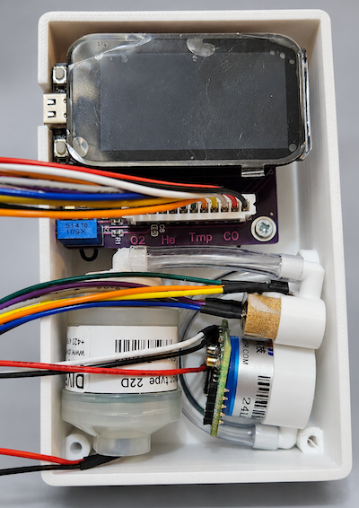
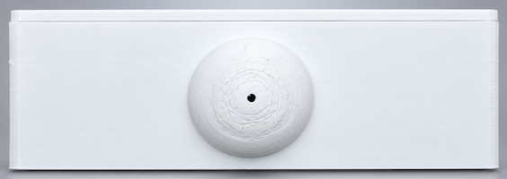
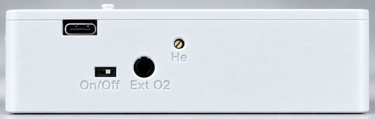

# DIY Scuba Gas Analyzer

A DIY scuba gas analyzer for oxygen (O2), helium (He), and carbon monoxide (CO).

**Contents**  
[Features](#features) | [Images](#images) | [User manuals](#user-manuals) | [Hardware](#hardware) | [Software](#software) | [Planned improvements](#planned-improvements)

## Features

- Detection of O2, He, and CO
- Compact and large-number readings screens
- Touch screen interface
- External O2 sensor support and auto-detection via a coaxial jack, with separate calibration data
- Air, optional pure-O2, and helium calibration
- Configurable sensors, CO correction, ppO2 limits, display brightness, and sleep timing
- Firmware update via WiFi
- Compact box design - current 3D print is 70x110x36mm (without the removable mushroom flow limiter)
- Built-in battery with USB-C charging (can be built with a different lithium battery)

## Images

<table align="center">
  <tr>
    <td align="center">
      <br>
      <strong>Front</strong>
    </td>
    <td align="center">
      <br>
      <strong>Inside view</strong>
    </td>
    <td align="center">
      <br>
      <strong>Inlet</strong>
    </td>
    <td align="center">
      <br>
      <strong>Side with ext O2 connector, USB-C port,</br> He adjustment, On/Off switch</strong>
    </td>
  </tr>
</table>

<table align="center">
  <tr>
    <td align="center">
      <br>
      <strong>Readings</strong>
    </td>
    <td align="center">
      <br>
      <strong>Large readings</strong>
    </td>
    <td align="center">
      <br>
      <strong>Calibration</strong>
    </td>
  </tr>
</table>

## User manuals

- [English](docs/user-manual.md)
- [Български](docs/user-manual.bg.md)

## Hardware

Some elements are available in different versions, depending on how the board is built. For example, use SMD components for a PCB, or build on perfboard or a breadboard.

- [Lilygo S3 ESP32](https://www.lilygo.cc/products/t-display-s3) (about $24) - ESP32 controller with a built-in touch display, dual-core processor, LiPo power, and charging.
- [ADS1115](https://aliexpress.com/item/1005001703504835.html) (2 x about $1) - 16-bit analog-to-digital converters for reading sensor values.
- [3 V voltage regulator](https://www.ti.com/product/TPS782/part-details/TPS78230DDCT) or similar. The helium sensor requires 3.0 V. Use a regulator with an enable pin so the ESP32 can turn the sensor off when it is not used.
- [5 V voltage regulator](https://eu.mouser.com/ProductDetail/Texas-Instruments/TPS61240DRVR) or similar. The CO sensor requires 5.0 V to 12.0 V. Use a regulator with an enable pin so the ESP32 can turn the sensor off when it is not used.
- [LM35DZ temperature sensor](https://aliexpress.com/item/32921896929.html) (about $2) for detecting when the helium sensor has warmed up.

Gas sensors:

- [O2 oxygen cell](https://www.aliexpress.com/item/1005006077026218.html) (about $21-$50) - A standard oxygen sensor. Cells are available from different suppliers; connectors can vary. Typical service life is ~2 years. Cheap Chinese ones have shorter life, but also work well.
- [Winsen MD61 or MD62 helium sensor](https://www.aliexpress.com/item/33019119435.html) (about $30) - A thermal-conductivity sensor for inert gases. It cannot identify different gases, so readings assume there are no other gases such as hydrogen or CO2. Readings use a Wheatstone bridge; solder the sensor and bridge to avoid resistance changes from unstable connectors. Typical service life is 10 years. The sensor warms to about 25 C after power-on, usually in 1-2 minutes depending on starting temperature. Warm-up can use up to 120 mA. The sensor is sensitive to CO2, so breath near it affects readings.
- [Winsen ZE15-CO or ZE07-CO carbon monoxide sensor](https://www.aliexpress.com/item/4001321584178.html) (about $10) - Measures 0-500 ppm CO. These sensors provide digital and analog outputs; this project uses the analog output (400 mV-2000 mV for 0-500 ppm). Typical service life is 3-5 years.

Other elements:

- LiPo battery providing 2.7-4.2 V. The Lilygo S3 is designed to power and charge the battery directly.
- Wheatstone bridge for the MD61 helium sensor, made from two 2 kOhm resistors and a 500 Ohm precision potentiometer (at least 10-15 turns).
- Capacitors for the voltage converters.

Expected runtimes and power consumption vary with enabled sensors and display brightness. Approximate runtime estimates at medium brightness, based on a 2000 mAh battery:

- **O2 sensor only:** 70 mA, about 28 hours
- **O2 and CO sensors:** 80 mA, about 25 hours
- **O2, CO, and He sensors:** 170 mA, about 12 hours
- **Display brightness:** about 35 mA difference between lowest and highest
- **Sleep mode:** about 250 uA

## Software

The application is developed with [PlatformIO](https://platformio.org/) and uses FreeRTOS tasks for the UI, sensor readings, and other work.

Libraries and tools:

- [TFT eSPI](https://github.com/Bodmer/TFT_eSPI), MCU graphics library and driver
- [LVGL](https://github.com/lvgl/lvgl), graphics library for ESP32 and Arduino
- [LVGL Pro Editor](https://lvgl.io/docs/pro), used to create the exported C UI with LVGL 9.5.0

### UI build and checks

The active UI is in [lvgl-ui-project](lvgl-ui-project/). Export changes from the Editor before building; PlatformIO compiles the exported C, fonts, and images, not the XML. Application bindings live in [UiAdapter.cpp](src/display/UiAdapter.cpp), outside generated files.

PlatformIO links the export directly via `gas-analyzer-ui=symlink://lvgl-ui-project`. [library.json](lvgl-ui-project/library.json) selects the source directories and declares the LVGL dependency.

```sh
pio run -e t-display-s3
pio run -e t-display-s3-release
pio test -e native -e native-ui
```

## Planned Improvements

- [ ] Support metric and imperial units.
- [ ] Add a 180-degree screen rotation option.
- [ ] Remember the last screen on startup.
- [ ] Warn when the O2 sensor reading changes significantly between startups, such as after sensor replacement, and prompt the user to review calibration.
- [ ] Add translations for more languages.
- [ ] Add a gas calculator with best-mix suggestions.

## Based on ideas from:
- https://slideplayer.fr/slide/10883088
- https://scubaboard.com/community/threads/nitrox-trimix-co-analyzer.595564
