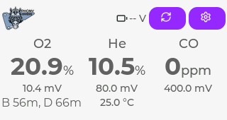
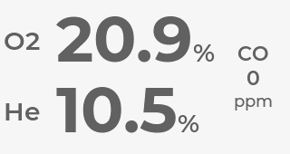
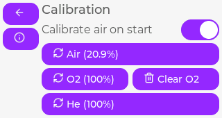
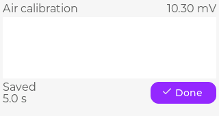
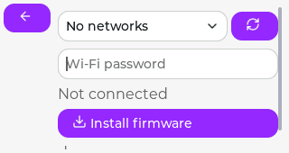

# Ръководство за потребителя на анализатора за газове

Този анализатор е самоделно устройство и не е сертифициран. Употребата му е на ваша отговорност.

## Измерване на газ

Включете анализатора и изчакайте всички активирани сензори да се стабилизират. Главният екран показва кислород, хелий, въглероден оксид, състояние на батерията и напрежение на сензорите. Докоснете произволно място на екрана с показанията, за да превключите между компактния изглед и изгледа с големи цифри.

`Warming` означава, че сензорът все още не е готов. `Stale` означава, че анализаторът не е получил скорошно валидно измерване; изчакайте ново показание, преди да разчитате на него. `Unavailable` означава, че сензорът или необходимо допълнително измерване в момента не може да даде стойност. Индикаторът за предупреждение отваря екран, където са показани последните предупреждения и грешки.

### MOD, CO и батерия

Стойностите `B` и `D` под показанието за кислород са максималните работни дълбочини (MOD). Те се изчисляват от измерения процент кислород и зададените в **Settings** граници за ppO2 при дъно и декомпресия. `B` използва границата за ppO2 при дъно, а `D` - границата за ppO2 при декомпресия. Проверете избраните граници и анализа на газа, преди да разчитате на която и да е от дълбочините.

Стойността за CO става червена, когато анализаторът открие CO над 0 ppm. Проверете газа и не го използвайте, докато не бъде потвърдено, че е безопасен.

Напълно заредена батерия е около 4.2 V. Заредете преди да спадне под около 3.0 V. Използвайте настройката **Sleep**, за да премине анализаторът в ниска консумация след няколко минути бездействие; изберете `Off` само когато е необходима непрекъсната работа. Sleep значително намалява консумацията, когато анализаторът не се използва. Оставете анализатора включен при активно обновяване на фърмуера.

## Калибриране

От главния екран докоснете бутона с кръгова стрелка **Calibration**. Изберете калибрирането, което съответства на използвания референтен газ:

- **Air calibration** за калибриране на О2 сензора с въздух.
- **Pure O2 calibration** за калибриране на О2 сензора с 100% кислород.
- **Helium calibration** за калибриране на He сензора с 100% хелий.

Стартирайте калибриране само след като подадете стабилен референтен газ към сензорите. Анализаторът отчита стойността на сензора и изчаква стабилно показание. Той записва калибрирането след поне пет стабилни секунди. Графиката спира и екранът показва `Saved`, когато операцията е завършена; използвайте **Done**, за да се върнете към екрана за калибриране. Използвайте **Cancel**, за да спрете текущо калибриране.

Ако калибрирането отчете невалиден диапазон, нестабилен сигнал или неуспешен запис, не използвайте направения опит. Проверете референтния газ, връзката на сензора и загряването на сензора, след което опитайте отново. Настройката **Calibrate on startup** прави О2 калибриране с въздух след всяко включване.

## Настройки

От главния екран отворете **Settings**, за да включите или изключите сензори и да настроите кислородните граници, яркостта и времето до заспиване. Промените се записват при излизане от екрана. Ако анализаторът е зает или стойността е невалидна, предишната действаща настройка се запазва и се показва грешка.

## Обновяване на фърмуера

Отворете **Settings**, след това **Firmware Update**. Екранът показва инсталираната версия на фърмуера.

1. Изберете **Scan Wi-Fi**.
2. Изберете Wi-Fi мрежата след завършване на сканирането.
3. Въведете паролата за Wi-Fi.
4. Изберете **Install firmware** и оставете анализатора включен до завършване на операцията.

Състоянието на обновяването показва текущата стъпка от мрежовата връзка или инсталацията. Не стартирайте друга операция, докато сканиране или обновяване вече е в ход.